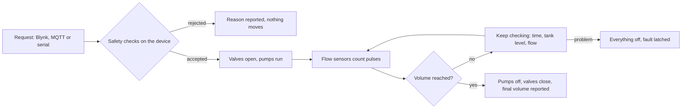
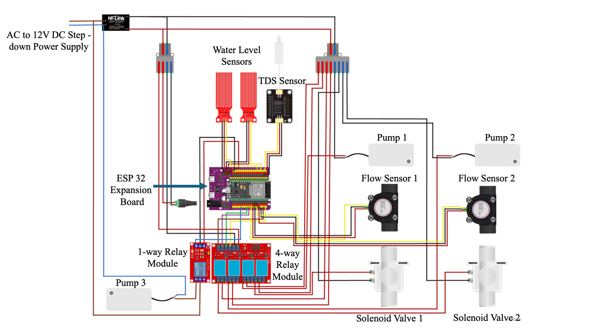

<div align="center">

# 🌱 IoT-Based Fertiliser Mixing System for Precision Farming

**ESP32 firmware for automated two-channel hydroponic fertiliser dosing, with live monitoring over Blynk and/or MQTT**

[](LICENSE)
[](https://www.espressif.com/en/products/socs/esp32)
[](https://www.arduino.cc/en/software)
[](https://journal.uthm.edu.my/index.php/ijie/article/view/24386)

</div>

---

## 📄 Publication

If you use this code or build on this work, please cite the paper. Citation as given by the journal (APA style):

> Sri Tulasi Ram Rajalingam, Muhammad Muzakkir Mohd Nadzri, Afandi Ahmad, & Mohamad Khairi Ishak. (2026). IoT-Based Fertiliser Mixing for Precision Farming. *International Journal of Integrated Engineering*, *18*(1), 186–201. https://journal.uthm.edu.my/index.php/ijie/article/view/24386
>
> DOI: [10.30880/ijie.2026.18.01.014](https://doi.org/10.30880/ijie.2026.18.01.014)

BibTeX (the journal's own fields; the DOI is from the paper's first page):

```bibtex
@article{rajalingam2026fertiliser,
  title   = {IoT-Based Fertiliser Mixing for Precision Farming},
  author  = {Sri Tulasi Ram Rajalingam and Muhammad Muzakkir Mohd Nadzri and Afandi Ahmad and Mohamad Khairi Ishak},
  journal = {International Journal of Integrated Engineering},
  volume  = {18},
  number  = {1},
  pages   = {186--201},
  year    = {2026},
  month   = apr,
  url     = {https://journal.uthm.edu.my/index.php/ijie/article/view/24386},
  doi     = {10.30880/ijie.2026.18.01.014}
}
```

The journal also offers other formats (IEEE, Chicago, Harvard, MLA and more) and a BibTeX/RIS download on the [article page](https://journal.uthm.edu.my/index.php/ijie/article/view/24386).

---

## 📌 What it does

Two pump-and-valve channels dispense a requested volume of fertiliser concentrate into a hydroponic mixing line. Flow sensors measure each channel; a TDS probe and two water-level sensors report the state of the system. You control and watch it from the Blynk app or over MQTT.



| Feature | Detail |
|---|---|
| 💧 Two-channel dosing | Pump + solenoid per channel, closed on flow-sensor feedback, each channel stops at its own target |
| 🎯 Self-correcting volume | Learns how much liquid still flows after each pump stops, switches off early, and reports the final volume once the valves have closed |
| 🛡️ Local safety layer | Run-time limit, no-flow detection, tank-low interlock, volume limit, E-stop, watchdog, latched faults ([details](docs/safety.md)) |
| 📊 TDS monitoring | Median-filtered ADC readings; optional DS18B20 temperature compensation |
| 🎯 Calibration on the device | Flow sensors and TDS calibrated from the serial console or MQTT, saved in flash ([guide](docs/calibration.md)) |
| 🖥️ Serial console | `status`, `dispense`, `estop`, `cal ...` over USB, works offline |
| 🪣 Tank levels | Two sensors, Low / Medium / High, colour-coded in Blynk |
| 📱 Blynk and/or MQTT | Enable either or both with one line in `config.h` |
| ⚙️ Non-blocking | Network trouble never stops the control loop or leaves a pump running |

## 🗂️ Repository layout

```
├── firmware/fertilizer_system/   Arduino sketch (open this folder in Arduino IDE)
├── docs/                         Guides and reference (see below)
├── tests/                        Host-side unit tests for the pure logic (run on a PC and in CI)
├── tools/                        make_charts.py: regenerates the result charts as SVG
├── hardware/                     Bill of materials and Fritzing circuit layout
├── legacy/                       Original paper-prototype sketches and earlier test sketches, frozen
├── CHANGELOG.md  CONTRIBUTING.md  LICENSE
```

## 🚀 Quick start

1. Install Arduino IDE 2.x and the **esp32** board package, plus the Blynk (and/or PubSubClient + ArduinoJson) libraries.
2. Copy `firmware/fertilizer_system/config.h.example` to `config.h`, fill in WiFi and Blynk or MQTT details.
3. Check the safety limits and calibration values in `settings.h`.
4. Flash, open Serial Monitor at 115200 baud, and test **with water only**.

Full walk-through: **[docs/getting-started.md](docs/getting-started.md)**.

> ⚠️ **Safety:** this controls pumps and valves. Always run the [bench tests](docs/bench-tests.md) with water before connecting nutrient reservoirs, and never leave a new setup unattended. The default safety limits are placeholders: set them for your hardware.



## 🛠️ Hardware at a glance

| Component | GPIO | Notes |
|---|---|---|
| Pump 1 / Pump 2 | 16 / 17 | via 4-channel 12 V relay module (active-HIGH), never directly from a GPIO |
| Solenoid 1 / Solenoid 2 | 22 / 23 | via driver with flyback diode |
| Flow sensor 1 / 2 | 18 / 19 | interrupt, `INPUT_PULLUP` |
| TDS sensor | 36 | ADC1 |
| Water level 1 / 2 | 34 / 35 | ADC1 |

All analog sensors must be on **ADC1**: ADC2 is unreliable while WiFi is on. Full wiring notes: [docs/hardware.md](docs/hardware.md).

## 📚 Documentation

| Guide | What's in it |
|---|---|
| [Getting started](docs/getting-started.md) | Install, configure, flash, first dispense |
| [Hardware](docs/hardware.md) | System layout, parts, pin map, relay notes, bill of materials |
| [Results](docs/results.md) | Measured accuracy and response time from the project evaluation |
| [Blynk setup](docs/blynk-setup.md) | Template, datastreams, dashboard widgets |
| [MQTT contract](docs/mqtt-contract.md) | Topics and payloads for the MQTT option |
| [Calibration](docs/calibration.md) | Flow sensors, TDS, water levels |
| [Safety](docs/safety.md) | Safety requirements, fault codes |
| [Bench tests](docs/bench-tests.md) | Pre-deployment test checklist |
| [Architecture](docs/architecture.md) | Modules, loop, state machine, data flow |
| [Troubleshooting](docs/troubleshooting.md) | Symptoms, causes, fixes, log guide |
| [Development history](docs/development-history.md) | How the prototype evolved, calibration trail, lessons learned |
| [Roadmap](docs/roadmap.md) | Known limitations and planned work |
| [Design decisions](docs/adr/) | Why things are the way they are |

## 🧪 Status

| Area | State |
|---|---|
| Legacy code (paper prototype, `legacy/`) | ✅ **Tested on the actual hardware**: the version used in the publication; measured results in [results.md](docs/results.md) |
| Current firmware (`firmware/`) compiles (esp32 core 4.0.0; Blynk / MQTT / DS18B20 combinations) | ✅ |
| Pure-logic unit tests (`tests/`) | ✅ pass on a PC |
| GitHub Actions build + test workflow | ⏳ added, not yet run on GitHub |
| Current firmware's new features (safety layer, calibration and profiles, run-on compensation, MQTT, serial console) tested on hardware | ⏳ not yet. Checklist: [bench-tests.md](docs/bench-tests.md) |

## 📜 License

MIT, see [LICENSE](LICENSE). **Academic use:** please cite the paper above.

## 👤 Author

**Sri Tulasi Ram Rajalingam**
