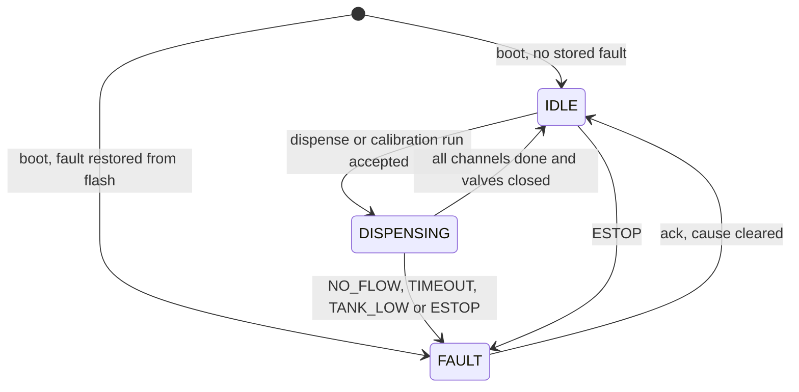
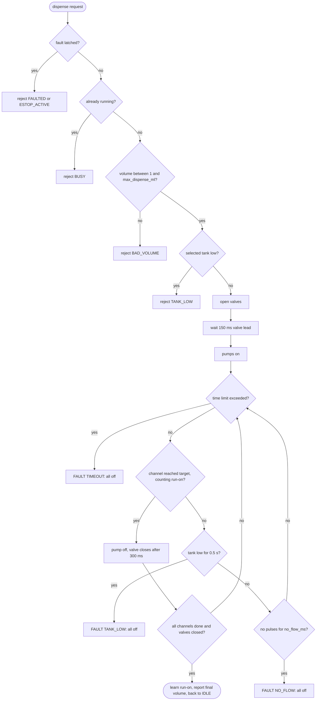

# Architecture

How the firmware (v1.2.0) is organised and why. Source: [`firmware/fertilizer_system/`](../firmware/fertilizer_system/).

## Big picture

```
 Sensors                    ESP32                         Outputs / Cloud
┌──────────────┐   ┌──────────────────────────┐   ┌──────────────────────────┐
│ Flow ×2      │──►│ flow ISRs (IRAM)         │   │ Pump ×2, Solenoid ×2     │
│ Water level×2│──►│ level   (tank-low)       │──►│  (via drivers)           │
│ TDS          │──►│ tds     (median filter)  │   └──────────────────────────┘
└──────────────┘   │ dispenser (state machine │   ┌──────────────────────────┐
                   │   + ALL safety rules)    │◄─►│ Blynk app   (USE_BLYNK)  │
                   │ net  ─ Blynk / MQTT      │◄─►│ MQTT broker (USE_MQTT)   │
                   └──────────────────────────┘   └──────────────────────────┘
```

**Design rule:** the device is the safety authority. Blynk and MQTT only *request* actions; [`dispenser.cpp`](../firmware/fertilizer_system/dispenser.cpp) validates every request and enforces every limit, whether or not the network is up ([ADR 0002](adr/0002-device-is-safety-authority.md)).

## Modules

| File | Responsibility | Depends on |
|---|---|---|
| `fertilizer_system.ino` | `setup()` / `loop()`, watchdog | everything below |
| `settings.h` | Pins, calibration, **safety limits** | `config.h` |
| `config.h` | WiFi, transports, secrets (git-ignored; copy from `config.h.example`) | none |
| `dispenser.cpp/.h` | Dispense and calibration-run state machine, flow ISRs, faults, E-stop | `calibration`, `level`, `net` |
| `calibration.cpp/.h` | Flow-factor profiles and TDS factor saved in ESP32 flash (NVS) | `settings` |
| `safety_limits.cpp/.h` | Safety limits and level thresholds, saved in flash, serial-only to change | `settings` |
| `faultstore.cpp/.h` | Remembers a latched fault across resets | none |
| `logic.h` | Pure functions (median, level classes, run-on maths) unit-tested on a PC | none |
| `temperature.cpp/.h` | Optional DS18B20 water temperature (`ENABLE_DS18B20`) | `settings` |
| `serial_console.cpp/.h` | Text commands over USB serial (works offline) | `dispenser`, `calibration`, `tds` |
| `level.cpp/.h` | Water-level sampling, Low/Medium/High, tank-low detection | `settings` |
| `tds.cpp/.h` | ADC sampling, median filter, ppm conversion | `settings` |
| `net.cpp/.h` | WiFi, device ID, fan-out to enabled transports | transports |
| `net_blynk.cpp` | Blynk virtual pins and publishing | `dispenser`, `level`, `tds` |
| `net_mqtt.cpp` | MQTT topics per [mqtt-contract.md](mqtt-contract.md) | `dispenser`, `level`, `tds` |

`dispenser` never talks to Blynk or MQTT directly. It calls `netPublish*()`, which fans out to whichever transports are enabled. Transports call `dispenserRequest()`, `dispenserEstop()` and `dispenserAckFault()`. Adding a new transport means one new file.

## Main loop

```
loop():
  esp_task_wdt_reset()     feed the watchdog (8 s)
  tdsSample()              ADC read every 40 ms into a 30-sample ring buffer
  tempLoop()               non-blocking DS18B20 read (only if enabled)
  consoleLoop()            serial commands, one line at a time
  dispenserLoop()          level sample (100 ms), E-stop button, valve timers, dispense update
  netLoop()                Blynk.run() / mqtt.loop(), reconnect attempts, periodic publishing
```

Safety runs before networking on every pass. Nothing in the loop blocks for long: WiFi connects in the background and reconnect attempts are skipped while a dispense is running (a connect attempt can take about 2 s).

| Task | Period | Where |
|---|---|---|
| TDS ADC sample | 40 ms | `tds.cpp` |
| Level sample | 100 ms | `level.cpp` |
| TDS publish (Blynk) | 800 ms | `net_blynk.cpp` |
| Level publish (Blynk) | 1000 ms | `net_blynk.cpp` |
| Telemetry (MQTT) | 5000 ms | `net_mqtt.cpp` |
| Watchdog timeout | 8 s | `settings.h` |

## Dispense state machine



In `FAULT` every pump and valve is off and the fault is saved in flash. In `DISPENSING` the name shown to users is `CALIBRATING` during a calibration run.

### What happens during a dispense



During `DISPENSING`:

1. Solenoids open at t = 0. Pumps start after `SOLENOID_LEAD_MS`.
2. Each loop pass, per channel: read the pulse count, convert to ml (`pulses × ml-per-pulse`), then check in order:
   target reached → tank low → no flow.
3. A channel that reaches its target stops its pump immediately. Its solenoid closes `SOLENOID_LAG_MS` later.
4. An overall time limit applies: `volume / MIN_FLOW_ML_PER_S + TIMEOUT_GRACE_MS`.
5. When both channels finish, the result is published and the state returns to `IDLE`.

A calibration run uses the same state and the same checks, runs one channel for a fixed time instead of to a volume, and reports its pulse count (state name `CALIBRATING`).

**Run-on compensation.** When a pump is switched off, liquid keeps flowing for a moment (the pump coasts and the valve takes up to 0.3 s to close). The firmware counts the pulses between "pump off" and "valve closed" and keeps a moving average per channel (`runOnMl`, at most `RUNON_MAX_ML` and never more than half the request). The next dispense stops that much early, so the final volume lands on the target. It starts at 0, learns from each successful dispense, is forgotten when the flow factors change, and can be disabled with `ENABLE_RUNON_COMP 0`.

**Final volume.** A dispense is reported complete only after every valve has closed, so the volume in the event (and the pulse count of a calibration run) includes that run-on flow.

**Persistent faults.** Raising a fault writes it to flash; acknowledging clears it. After a reset the device restores the fault and stays in FAULT with outputs off.

Any fault turns **every** pump and valve off at once, publishes the partial result and the fault, and latches until acknowledged. Fault list: [safety.md](safety.md).

## Flow counting

Flow sensors raise a rising-edge interrupt per pulse. The ISR runs from IRAM, debounces (`FLOW_DEBOUNCE_US`) and increments a counter inside a `portMUX` spinlock. The main loop reads the counter under the same lock. (`noInterrupts()` is not enough on the dual-core ESP32, because it only masks the current core.)

## TDS pipeline

```
ADC (GPIO36) → 30-sample ring buffer → median → voltage (× 3.3/4096)
   → temperature compensation (÷ 1 + 0.02·(T − 25)) → cubic polynomial → × 0.5 × calibration factor → ppm
```

Temperature is the live DS18B20 reading if `ENABLE_DS18B20 1` and the sensor responds, otherwise a constant 23 °C. The calibration factor comes from flash. The buffer is filled at boot so early readings are valid.

## Network behaviour

- WiFi: started in `setup()` without waiting; ESP32 auto-reconnect handles drops.
- Blynk: `Blynk.config()` then a connect attempt every 5 s while idle and WiFi is up.
- MQTT: same pattern, with a last-will message so the broker marks the device offline.
- With neither transport enabled, the device still dispenses nothing by itself (commands arrive only over a transport) but sensors, safety and serial logging run.

## Extending

| To add | Touch |
|---|---|
| A third pump or sensor | `settings.h` (pin), `dispenser.cpp` (channel table), `level.cpp` |
| A new transport (e.g. HTTP, LoRa) | New `net_xxx.cpp` implementing the same hooks as `net_blynk.cpp`; add calls in `net.cpp` |
| A new fault | `FaultCode` in `dispenser.h`, `faultName()`, a check in `updateDispense()`, a row in [safety.md](safety.md) |
