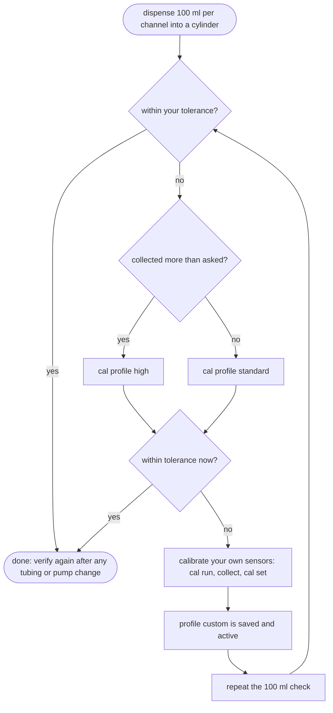

# Calibration

Calibrate each unit once when you build it, and again whenever tubing, pumps or probes change. Values are **saved on the device** (ESP32 flash) and survive reboots.

## Which route to take



## Flow-factor profiles

The flow factors (ml per pulse) come from one of three **profiles**. Switch between them at any time (not while dispensing); the choice is saved.

| Profile | Channel 1 | Channel 2 | When to use |
|---|---|---|---|
| `standard` (default) | 4.25 | 5.25 | The values used in the project report's accuracy tests ([results.md](results.md)) |
| `high` | 5.25 | 5.50 | The values in the final prototype sketch. Use when the dispensed volume comes out **too high** with `standard` |
| `custom` | yours | yours | Saved when you calibrate your own sensors with `cal set` (below) |

A higher factor means each pulse counts as more millilitres, so the pump stops sooner and less is dispensed. If you collect more than you asked for, move to a higher factor; if less, to a lower one.

| Interface | Switch profile |
|---|---|
| Serial | `cal profile standard`, `cal profile high`, `cal profile custom` |
| MQTT | `cmd/calibrate_profile` `{"id":"p1","profile":"high"}` |
| Blynk | V10: 0 = standard, 1 = high, 2 = custom |

`custom` can only be selected once you have saved a calibration (otherwise `NO_CUSTOM`). Saving a calibration with `cal set` switches to `custom` automatically; your `standard` and `high` presets are never overwritten, so you can switch back. The current profile appears in `status`, `cal show` and the MQTT `status` message (`flow_profile`).

You can calibrate from the **Serial Monitor** (115200 baud, works with no network) or over **MQTT**. Blynk shows the calibration run result but does not accept calibration commands.

## Flow sensors (ml per pulse)

Each flow sensor needs its own factor. In the prototype history it ranged from 4.5 to 7.0 ml/pulse ([development-history.md](development-history.md)).

**Two steps: run, then measure.**

1. Prime the line and put the outlet of **one** channel into a graduated cylinder (or a jug on a scale: 1 g ≈ 1 ml for water).
2. Start a calibration run. The pump runs for a fixed time (default 5 s, at most 15 s) with all the normal safety checks, and the pulses are counted:

   | Interface | Command |
   |---|---|
   | Serial | `cal run 1` (or `cal run 1 8` for 8 s) |
   | MQTT | `cmd/calibrate_run` `{"id":"c1","channel":1,"duration_s":5}` |

   The result appears as `Calibration run done: channel 1, 87 pulses in 5000 ms` (Serial), on Blynk V9, and as an MQTT `event/calibration`.
3. Read the volume you collected, for example 456 ml.
4. Tell the device:

   | Interface | Command |
   |---|---|
   | Serial | `cal set 1 456` |
   | MQTT | `cmd/calibrate` `{"id":"c2","channel":1,"measured_ml":456}` (the `resp` contains the new `factor`) |

   The factor is `measured_ml ÷ pulses` (here 456 ÷ 87 = 5.241 ml/pulse). It is applied immediately, saved, and the profile becomes `custom`.
5. Repeat for channel 2.
6. **Verify:** dispense 100 ml per channel three times and compare with the cylinder. Recalibrate if the average is off by more than your tolerance.

Guards: a result needs at least 10 pulses (`CAL_MIN_PULSES`) and must be between 0.1 and 50 ml/pulse, otherwise it is rejected and nothing changes. Each run can be used for one calibration. If the run faults (for example `NO_FLOW` because the sensor is unplugged), nothing is stored.

> Use a run long enough to collect a decent volume (100 ml or more). A larger sample averages out the one-pulse granularity.

The pulse count is taken after the valve has closed, so it covers the liquid that kept flowing after the pump stopped, which is exactly what you collect in the cylinder.

## Setting the safety limits from your measurements

After `cal set` the console prints your measured flow rate and a suggested limit, for example `Measured flow about 91.2 ml/s. Suggested safety limit: set min_flow 45.6`. The firmware's timeout uses `min_flow` (default 1.0 ml/s, very conservative: a 500 ml dispense could run for about 8 minutes before the time limit trips). Setting it to about **half of the slowest channel's measured rate** stops a blocked line or weak pump quickly without false alarms.

```
set min_flow 45.6        # ml/s
set no_flow_ms 4000      # must be longer than the pump's priming time
limits                   # show all limits
```

Limits are saved on the device and can only be changed from the serial console (never remotely). `limits reset` restores the defaults in `settings.h`.

## TDS sensor

1. Use a reference solution of known TDS (for example 1000 ppm). Let the probe and solution reach the temperature you will normally run at. With a DS18B20 fitted, the reading is compensated automatically.
2. Wait for the reading to settle (check with `status`).
3. Calibrate:

   | Interface | Command |
   |---|---|
   | Serial | `cal tds 1000` |
   | MQTT | `cmd/calibrate` `{"id":"c3","target":"tds","reference_ppm":1000}` |

   The stored factor is scaled so the current reading equals the reference. The reading must be above 10 ppm (probe in the solution).
4. Check against a second reference solution.

### Temperature compensation

By default the firmware assumes **23 °C**. For accuracy at other temperatures, fit a DS18B20 on GPIO 4 (4.7 kΩ pull-up to 3.3 V), install the **OneWire** and **DallasTemperature** libraries and set `#define ENABLE_DS18B20 1` in `config.h`. If the sensor fails, the firmware falls back to 23 °C and `temp_c` is no longer published.

## Water-level thresholds

Read the raw ADC value (`status`) with the sensor dry, half-submerged and fully submerged, and put the boundaries between those readings, then save them: `set level_low 700` and `set level_med 1200` (the paper's ranges 0-700, 701-1200, 1201+ are the defaults). They are stored on the device; serial console only.

## Viewing and resetting

| | Serial | MQTT |
|---|---|---|
| Show | `cal show` or `status` | `flow_profile` in the `status` message |
| Reset: `standard` profile, custom values and TDS factor erased | `cal reset` | `cmd/calibrate_reset` `{"id":"c4"}` |

## Schedule

Flow sensors: when tubing or pumps change. TDS: monthly, or when readings drift.
