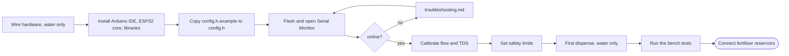

# Getting Started

From a bare ESP32 to a first successful dispense. Allow about an hour, plus time to wire hardware.



## 0. Before you begin

- Hardware wired per [hardware.md](hardware.md), with **pumps plumbed water-to-water**. Do not connect nutrient reservoirs until you have run the [bench tests](bench-tests.md).
- A 2.4 GHz WiFi network (the ESP32 does not support 5 GHz).
- A [Blynk](https://blynk.io/) account (free tier works) **and/or** an MQTT broker such as Mosquitto.

## 1. Install Arduino IDE and the ESP32 board package

1. Install **Arduino IDE 2.x**.
2. *File → Preferences → Additional boards manager URLs*, add:
   `https://espressif.github.io/arduino-esp32/package_esp32_index.json`
3. *Tools → Board → Boards Manager*, search **esp32**, install **esp32 by Espressif Systems**.
4. *Tools → Board → ESP32 Arduino → ESP32 Dev Module* (or the one matching your board).

## 2. Install libraries (Library Manager)

| You use | Install |
|---|---|
| Blynk | **Blynk** ≥ 1.3.0 |
| MQTT | **PubSubClient** (Nick O'Leary) and **ArduinoJson** 7.x |

Install only what you enable. The sketch compiles with any combination of the two transports, or with neither.

## 3. Configure

1. Open the folder `firmware/fertilizer_system/` in Arduino IDE (File → Open → `fertilizer_system.ino`).
2. In that folder, copy `config.h.example` to `config.h`.
3. Edit `config.h`:
   ```cpp
   #define WIFI_SSID  "your-wifi"
   #define WIFI_PASS  "your-password"
   #define USE_BLYNK  1     // 1 = enable
   #define USE_MQTT   0     // 1 = enable (both can be on)
   ```
4. For Blynk, set `BLYNK_TMPL_ID` and `BLYNK_TOKEN` (see [blynk-setup.md](blynk-setup.md)). For MQTT, set `MQTT_HOST`, `MQTT_PORT`, and credentials if your broker needs them.

`config.h` is git-ignored. Never commit it.

## 4. Review the safety limits

Open [`settings.h`](../firmware/fertilizer_system/settings.h) and check, at minimum (these are defaults: the limits can be changed from the Serial Monitor without reflashing, see step 7):

| Setting | Why it matters |
|---|---|
| `MAX_DISPENSE_ML` | Largest volume the device will accept per command |
| `MIN_FLOW_ML_PER_S` | Sets the maximum run time. Set it a little below your pump's real flow rate |
| `NO_FLOW_TIMEOUT_MS` | How long a pump may run with no flow pulses |
| Flow profile | Millilitres per flow pulse. Start with `standard`, try `high` if volumes run high, then calibrate your own: see [calibration.md](calibration.md) |
| `TANK_SENSOR_FOR_CHANNEL` | Which level sensor watches which pump's source tank |

## 5. Flash

1. Connect the ESP32 by USB, choose the port in *Tools → Port*.
2. Click **Upload**. If it hangs at "Connecting…", hold the board's **BOOT** button until the upload starts.
3. Open *Serial Monitor* at **115200 baud**.

Expected output:

```
Fertiliser mixing firmware 1.2.0-safety
Device ID: fm-a1b2c3
System ready.
TDS: 312 ppm
...
```

Note the **Device ID**. MQTT topics use it.

## 6. Check connectivity

- **Blynk:** the device shows online in the app within a few seconds of WiFi connecting. Water levels and TDS start updating.
- **MQTT:** `mosquitto_sub -h <broker> -t 'fert/<device id>/#' -v` should show `status` and, every 5 s, `telemetry`.

If not, see [troubleshooting.md](troubleshooting.md).

## 7. Calibrate

Before trusting any volume, calibrate the two flow sensors ([calibration.md](calibration.md)). It takes about two minutes per channel from the Serial Monitor:

```
cal run 1          # pump 1 runs for 5 s; collect the output
cal set 1 456      # you measured 456 ml
cal run 2
cal set 2 441
cal tds 1000       # probe in a 1000 ppm reference solution
```

Then set the safety limits from what you measured (the console suggests `min_flow` after `cal set`) and check the water-level thresholds:

```
limits                  # show current limits
set min_flow 45         # about half your slowest channel's ml/s
set level_low 700       # raw ADC values for Low / Medium
set level_med 1200
```

Type `help` in the Serial Monitor for all commands.

## 8. First dispense (water only)

1. Put the source hoses in water and the outlets in a graduated cylinder (or two).
2. Send a small volume, such as **50 ml**: type `dispense 50` in the Serial Monitor, use Blynk V1, or `cmd/dispense` over MQTT.
3. Watch Serial: both pumps start, each stops at its own target, the total is reported.
4. Compare the cylinders with the reported volume; adjust the calibration factors.

## 9. Run the bench tests

Work through [bench-tests.md](bench-tests.md), especially the failure cases (unplugged sensor, empty tank, E-stop, WiFi loss). Only then connect real nutrient reservoirs.
