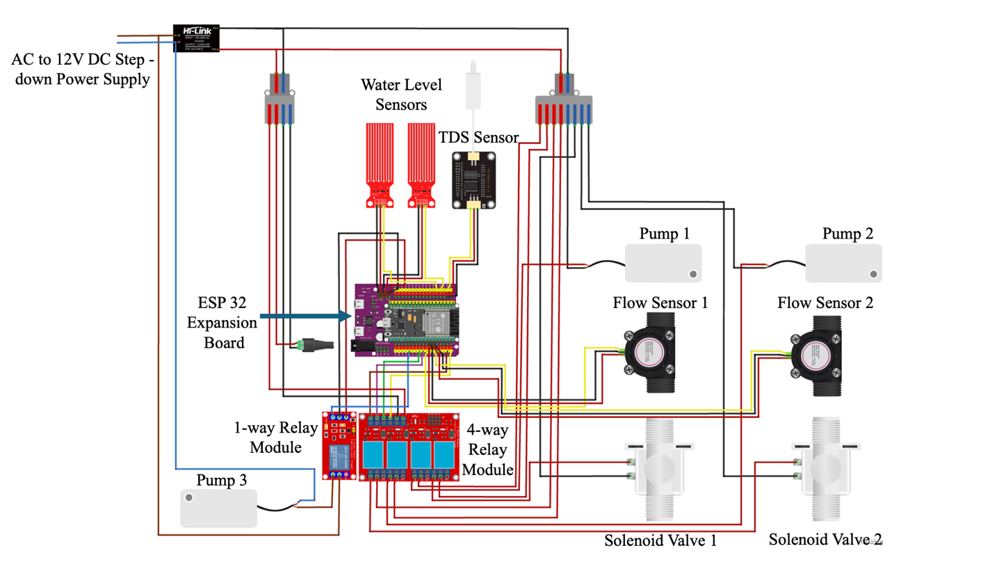
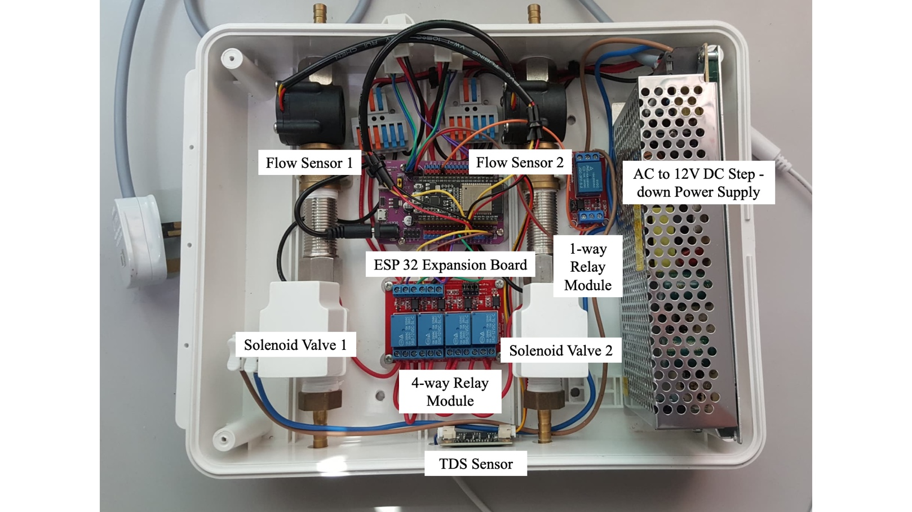

# Hardware



*Circuit diagram (Fritzing breadboard view, FYP report Figure 3.32). Editable source: [`hardware/final-layout.fzz`](../hardware/final-layout.fzz). Process flowchart: [images/process-flowchart.png](images/process-flowchart.png).*

## How it fits together

Two fertiliser reservoirs, **A** and **B**, each hold a 12 V submersible pump and a water-level sensor. When a dispense is requested, for each channel:

```
Reservoir (pump + level sensor) ──► flow sensor (YF-S201) ──► solenoid valve ──► water storage tank
                                                                                      │
                                         TDS probe ◄─────────────────────────────────┘
```

The ESP32 counts flow-sensor pulses to measure volume, switches the dosing pumps and valves through a relay module, and reads the TDS probe in the storage tank. A mains-powered pump in that tank **runs continuously** to keep the solution mixed; the firmware does not control it. The dosing side runs from one 12 V 10 A supply.

Channel 1 = reservoir A, channel 2 = reservoir B. The paper and the project report both describe the two level sensors as monitoring the fertiliser AB level in the reservoirs, with thresholds 0-700 (Low), 701-1200 (Medium) and above 1200 (High), which are the values in `settings.h`.



*The assembled enclosure, top view (FYP report Figure 3.35).*

## Components

Full list with specifications: [`hardware/bom.csv`](../hardware/bom.csv). Summary:

| Part | Model / type | Notes |
|---|---|---|
| Controller | NodeMCU ESP-WROOM-32 on a 38-pin expansion board | Expansion board converts 12 V to 5 V for the ESP32 |
| Load switching | 4-channel 12 V relay module (opto-isolated) | Pump 1, pump 2, valve 1, valve 2 |
| Mixing-pump switching | 1-channel 5 V relay module | Feeds the 240 V AC mixing pump, which runs **continuously** (not firmware-controlled) |
| Dosing pumps (×2) | 12 V DC submersible | 4.2 W, max 240 L/h, IP68 |
| Valves (×2) | 12 V DC solenoid, normally closed, G1/2 | 15 W, 1.25 A; opens ≤ 0.15 s, closes ≤ 0.3 s |
| Flow sensors (×2) | YF-S201 | 1-30 L/min; about 4.25-5.5 ml per pulse in this build |
| TDS sensor | TDS Meter V1.0 with waterproof probe | 0-1000 ppm, ±10% F.S. at 25 °C, output 0-2.3 V |
| Level sensors (×2) | Analog resistive trace sensor | Low / Medium / High by threshold, not an exact volume |
| Mixing pump | Sobo WP-200D | 220-240 V AC, 25 W, 1800 L/h |
| Supply | S-120-12, 12 V 10 A | Overload, overvoltage and short-circuit protected |
| Enclosure | E8 E1000 PVC box, 32 × 25 × 13 cm | Houses ESP32, relays, supply, sensors' electronics |

> ⚠️ **Mains voltage.** The mixing pump and the 12 V supply run from 240 V AC. Only a competent person should wire the mains side, in an enclosed, fused and (ideally) RCD-protected circuit, away from the wet parts.

## Pin map

| Function | GPIO | Notes |
|---|---|---|
| Pump 1 | 16 | Relay module input (active-HIGH in the code) |
| Pump 2 | 17 | Relay module input |
| Solenoid valve 1 | 22 | Relay module input |
| Solenoid valve 2 | 23 | Relay module input |
| Flow sensor 1 | 18 | `INPUT_PULLUP`, rising-edge interrupt |
| Flow sensor 2 | 19 | `INPUT_PULLUP`, rising-edge interrupt |
| TDS sensor | 36 | ADC1 |
| Water level 1 (reservoir A) | 34 | ADC1, input-only |
| Water level 2 (reservoir B) | 35 | ADC1, input-only |
| E-stop button (optional) | 27 | Only if `ENABLE_ESTOP_BUTTON 1` |
| DS18B20 (optional) | 4 | Only if `ENABLE_DS18B20 1`; 4.7 kΩ pull-up to 3.3 V |

All analog inputs must stay on **ADC1** (GPIO 32-39): ADC2 is unreliable while WiFi is active.

## Wiring (from the Fritzing project)

Read from [`hardware/final-layout.fzz`](../hardware/final-layout.fzz), the project behind the circuit diagram above. Labels are as drawn there.

**4-channel relay module** (inputs driven by the ESP32, loads on the normally-open contacts):

| Relay channel | Driven by | Load (as labelled in Fritzing) |
|---|---|---|
| IN1 / NO1 | GPIO 23 | VALVE1 |
| IN2 / NO2 | GPIO 16 | WATER PUMP1 |
| IN3 / NO3 | GPIO 17 | WATER PUMP2 |
| IN4 / NO4 | GPIO 22 | VALVE2 |

**Sensors:**

| Sensor | Signal | Power |
|---|---|---|
| YF-S201 flow meter 1 | GPIO 18 | expansion-board VCC rail, GND |
| YF-S201 flow meter 2 | GPIO 19 | expansion-board VCC rail, GND |
| TDS meter V1.0 | GPIO 36 (SVP) | expansion-board VCC rail, GND |
| Water level sensor 1 | GPIO 34 | 3V3, GND |
| Water level sensor 2 | GPIO 35 | 3V3, GND |

**Mixing pump:** the 1-channel relay is powered from 5 V and GND; its contacts feed the WP-200D (the drawing also includes an AC-DC module for the mains side).

**Power:** the 12 V 10 A supply feeds the relay-module coil supply, the 12 V pumps and valves (through the relay contacts) and the ESP32 expansion board.

## Relay module

The firmware drives a pin **HIGH to switch a load ON**. Many relay modules, including the common 4-channel opto-isolated ones, have a **high/low trigger jumper**. Set it to *High*, or the pumps will run at boot and stop while dispensing. The pins are driven LOW as the first action in `setup()`, so a correctly configured module stays off through boot and reset.

Relay contacts are rated 10 A, far above the 1.25 A valve and 4.2 W pump loads. Still fit a **flyback diode** across each DC pump and valve to protect the supply and ESP32 from switching noise.

## Solenoid valve timing

The valve datasheet gives ≤ 0.15 s to open and ≤ 0.3 s to close. The firmware uses `SOLENOID_LEAD_MS = 150` (valve opens before the pump) and `SOLENOID_LAG_MS = 300` (valve closes after the pump) to match. The datasheet also lists a **minimum working pressure of 0.02 MPa**: if a valve does not open fully before the pump starts, increase `SOLENOID_LEAD_MS` and re-run bench test 13 ([bench-tests.md](bench-tests.md)).

## Prototype history notes

- **ADC1 only.** The first integrated build read the level sensors on GPIO 26 and 27 (ADC2) and moved them to 35 and 34 (ADC1) because ADC2 is unreliable with WiFi on.
- **Sensor numbering swapped between sketches.** `08_Monitoring_TDSwithLEVEL` reads sensor 1 on GPIO 35 and sensor 2 on GPIO 34; the final sketch, the Fritzing drawing and this firmware use 34 and 35. The firmware pairs level sensor 1 with pump 1 / reservoir A and sensor 2 with pump 2 / reservoir B (`TANK_SENSOR_FOR_CHANNEL` in `settings.h`).
- **One wording inconsistency in the report.** Section 3.5.2 of the project report calls the level reading "the current solution level in the mixing tank", while sections 3.3.2 and 3.3.5 and the paper put the sensors in the A and B reservoirs. This documentation follows the paper.

## Open points to verify on the physical build

1. **Valve pin pairing.** The Fritzing drawing labels the valve on GPIO 23 as VALVE1 and the one on GPIO 22 as VALVE2. The firmware (as in the original sketches that ran on the prototype) pairs pump 1 with the valve on **GPIO 22** and pump 2 with the valve on **GPIO 23**. Either the drawing's labels are only labels, or the pairing is crossed. If it is crossed, a dispense would open the wrong valve for each pump and fault with `NO_FLOW`. Check with `cal run 1` (bench test 30): flow must appear on channel 1's flow sensor.
2. **GPIO 2 on the mixing-pump relay.** The Fritzing drawing wires the 1-channel relay's input to GPIO 2, but the firmware never drives that pin and the pump is meant to run continuously. Confirm how the pump is actually powered. If that relay input is really on GPIO 2, note that GPIO 2 is a boot-strapping pin, so a continuously-on pump should not depend on it.
3. A wiring photo or exported schematic for this page.
