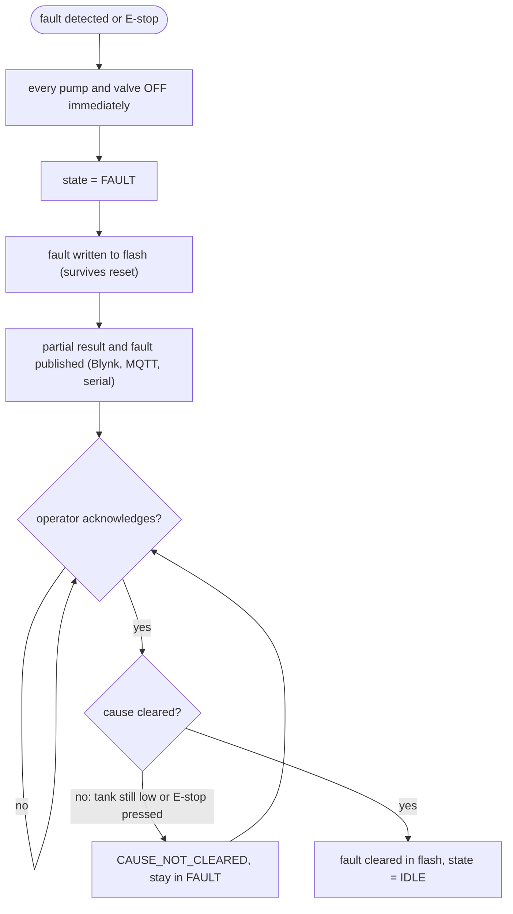

# Safety Requirements

IDs are referenced by firmware tests and commits (e.g. `feat: implement SAF-02`). All requirements are enforced **on the device**.

> **Scope.** These requirements cover the two dosing pumps and their valves. The 240 V mixing pump in the storage tank runs continuously and is **not** under firmware control, so an E-stop does not stop it. Isolate mains separately for that pump.

| ID | Requirement | Addresses v1 gap |
|---|---|---|
| SAF-01 | Each pump has a maximum run time per dispense, derived from the requested volume and a configured minimum flow rate. | Pump ran forever on sensor failure |
| SAF-02 | No-flow detection: if a running pump produces no pulses for `no_flow_timeout_s`, stop it and raise a fault. The timeout (`no_flow_ms`) and the minimum flow (`min_flow`, used for SAF-01) are adjustable from the serial console only. | Disconnected tube or empty tank |
| SAF-03 | Tank-low interlock: refuse to start, and stop if the source tank reads Low. | Level sensors were display-only |
| SAF-04 | Requested volume is clamped to `max_dispense_ml`; larger requests are rejected. | Unbounded V1 input |
| SAF-05 | E-stop (command and optional physical button) turns every pump and valve off immediately. | None existed |
| SAF-06 | Outputs are OFF at boot, on reset, and on watchdog reset. | Partially met |
| SAF-07 | Hardware watchdog is enabled; a stalled main loop resets the device. | None |
| SAF-08 | A fault latches until acknowledged and the cause has cleared. | None |
| SAF-09 | Solenoid opens before its pump starts and closes after it stops. | Met in v1 |
| SAF-10 | Network loss never changes pump state; a dispense in progress completes or faults locally. | Met in v1 |
| SAF-11 | A latched fault survives a reset or power cut: the device boots into FAULT (outputs off) until it is acknowledged. | A reset silently cleared faults |
| SAF-12 | Safety limits and level thresholds can only be changed from the serial console. No remote command (Blynk or MQTT) can relax them. | n/a |

## What happens when a fault is raised

## Fault codes

| Code | Meaning |
|---|---|
| `NO_FLOW` | SAF-02 triggered |
| `TIMEOUT` | SAF-01 triggered |
| `TANK_LOW` | SAF-03 triggered |
| `ESTOP` | SAF-05 triggered |
| `SENSOR_INVALID` | Sensor reading out of plausible range |

## Verification

Each requirement gets a bench test with water and simulated failures (unplug a flow sensor, empty a tank, drop WiFi). Pure logic (state machine, filters) is kept free of Arduino calls so it can also be tested on a PC with a plain C++ compiler.
